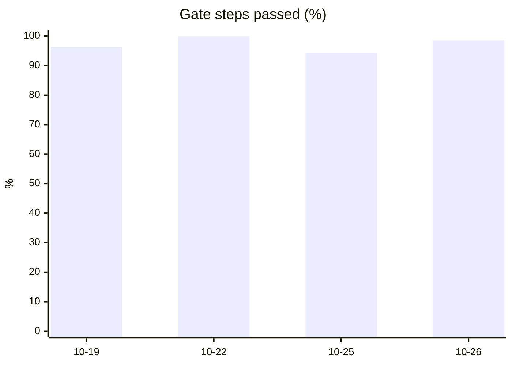

# cashcast

A private financial assistant for people in Canada. It reads exports from
your bank, card, broker and budgeting apps, on your computer only, and
plans your cash, cards, credit, tax and spending.

Your data never leaves your computer unless you say yes.

For anyone in Canada who uses a coding agent such as
[Claude Code](https://claude.com/claude-code). Several people can share one
copy; each person's data stays in their own folder.

**Start with Claude Code (one step):** open Claude Code (or Codex) and say:

```text
Install or update cashcast on this machine by following https://github.com/fyodoriv/cashcast/blob/HEAD/INSTALL.md (it updates an existing clone). Ask whether I only use cashcast or also contribute to it. Then run `scripts/doctor.sh` and fix every failing line with me. Audit the money skills and commands already on this machine against cashcast's and propose adopt or merge for each one. From now on, extend cashcast instead of building local copies. Then start cashcast for the first time with `/cashcast` and walk me through what it needs from me. At the end, list anything that could work better and offer an issue or PR for each.
```

The agent explains the plan, asks one round of questions (use or contribute,
who uses this copy), installs, runs the doctor, and starts the app with you.
Or set it up in one line (safe to run again; it ends with the doctor):

```bash
[ -d ~/apps/cashcast ] || git clone https://github.com/fyodoriv/cashcast.git ~/apps/cashcast; cd ~/apps/cashcast && git pull --ff-only && scripts/setup.sh && scripts/doctor.sh
```

Then add a person and open the plan:

```bash
bin/cashcast users add alex --province ON         # one folder per person
bin/cashcast web                                  # open the printed link: your plan, on this computer only
```

The setup installs what is missing (Rust, jq, yq, Node, pnpm) with Homebrew;
if Homebrew itself is missing, it prints the one line to install it. Later
runs of `cashcast` update a clean checkout and rebuild the engine and the
web app when they changed. CI proves this on a clean Mac (`scripts/fresh-mac.sh`).
For a guided first run, start your coding agent here (for
example `claude`) and type `/cashcast-start`; it asks only what the app cannot find.

Docs map: [docs/README.md](docs/README.md). Contributing: [CONTRIBUTING.md](CONTRIBUTING.md).

## Use cases

- Watch one number, your net total, grow, and see which move raises it most inside the limits you set.
- See whether your cash covers the next 15 months, and what you can invest.
- Pick the right card for each purchase, and pay each card down on time.
- Decide where new money goes: FHSA, RRSP, TFSA or non-registered.
- Get honest investment moves you can argue with: gain ranges with sources, risk and cost, "do nothing" ranked beside them, and your own overrides respected.
- Do a 5-minute monthly review and get dated tasks in Apple Reminders.
- Get groceries from the cheapest full basket: Claude reads 5+ stores in your Chrome, totals each with its fees and promos, and fills the carts; you check out. Ask "order groceries".
- Buy anything else well: 3-5 checked options on one page, with the card that pays the most cash back. Ask "find the best X".

## Features

From your exports, cashcast works out:

- **Net total, the main number:** everything you have (cash, Wise, investments,
  crypto) minus everything you owe (cards, loans), its trend over 30 and 365
  days, and every option ranked by what it adds a year. Options that break
  your `[boundaries]` (no burnout, a cash floor, risk, debt) show as refused,
  with the reason.
- **Forecast:** your cash for the next 15 months. The web app's Forecast view charts the next 12 with an 80 % range and the backtest accuracy.
- **Where to pay:** which card to use for each kind of spending.
- **Credit:** what each card should report, and when to pay it down.
- **Cash:** how much cash to keep and where new money goes (FHSA, RRSP, TFSA).
- **Tax:** your rates and the moves that cut tax.
- **Investment moves:** fees, account placement, idle cash, room, tax-loss harvesting and employer-stock concentration, ranked against "do nothing". Each gain is a range with its evidence; no stock picks or timing. You can challenge or override any move.
- **Spending:** where the money goes, and cheaper alternatives.
- **Spending checkup:** is last month more than usual, do you spend more than you earn, and how much interest and fees you paid, with APR in plain words (`bin/cashcast spending`).
- **Review:** a 5-minute monthly review, with dated tasks in your own Apple
  Reminders list.
- **Groceries:** a local price database of every store price Claude reads (best pack per 100 g/ml, organic within your premium, a substitute), each store's total with delivery, service fees and promos (full baskets first), and your grocery spend per month from the orders you log (`bin/cashcast grocery`, skill `grocery-cart`).
- **Purchases:** 3-5 real options from shops that deliver to you, one options page, and the card to pay with (skill `purchase`).

**The web app** is the main view. **Home** shows your net total first (its trend, its parts and the best next
step inside your boundaries), then the four numbers that matter,
the cash ahead and what to do next. **Plan ahead** shows month by month what
comes in, what goes out, what you can invest and what to do, with a "what if"
control for spending changes and one-off costs; the chart redraws as you
change it. The other views are Net total (every option, refused ones with the reason), Forecast, Monthly review, Where to pay, Credit,
Cash & investing, Tax, Payments, Budget, Alternatives, Documents (your notes,
for example moved from Notion), Bank sync (collect fresh exports, see every bank and card row MoneyWiz lacks, then send them with one confirmed click; you record only cash), Groceries (compare stores for the items you type, spend per month, store fees, your grocery rules), Categories (each MoneyWiz category beside its cashcast match; pick changes, preview, apply with a backup, undo), Holdings, Services, Knowledge, Privacy and Actions (every command, with a form; hard-to-undo ones ask to confirm). Each person in the household picks themselves in the
sidebar. On a phone, the main views sit in a bottom tab bar and the rest under
More. Design notes and sources: [`docs/design.md`](docs/design.md).

<!-- proof:start -->
## Proof

Each claim, why it should hold, and what real use shows. Results come from
content-free usage events each real run writes on its own machine
(command, ok or error, time, counts). Each machine shows as a salted hash.
No aggregate leaves a machine yet; until one is added here, a row says so.

| Claim | Theory | Metric | Result | Source |
|---|---|---|---|---|
| Real runs finish without an error. | A tool people trust is one whose real runs succeed (DORA change-failure rate, Forsgren et al. 2018). | Share of real `bin/cashcast` runs with result ok (`cashcast-engine proof field`) | not measured yet (field recording on since 2026-10-18) | not measured yet (field recording on since 2026-10-18) |
| Errors are rare in real use. | Each caught error is logged with the story it breaks, so the rate is countable. | Logged errors per 100 real runs (`cashcast-engine proof field`) | not measured yet (field recording on since 2026-10-18) | not measured yet (field recording on since 2026-10-18) |
| A run takes seconds, not a session. | Fast answers get used; slow ones get skipped. | Median real run time (median of each machine's median) (`cashcast-engine proof field`) | not measured yet (field recording on since 2026-10-18) | not measured yet (field recording on since 2026-10-18) |
| Tasks stay done everywhere. | A tick in Reminders, Calendar or Notion closes the task in the others, so you tick once. | Tasks ticked in one place and closed by `sync all` (`cashcast-engine proof field`) | not measured yet (field recording on since 2026-10-18) | not measured yet (field recording on since 2026-10-18) |
| You record only cash in MoneyWiz. | Rows cashcast adds are rows you do not type. | Bank and card rows `moneywiz sync` added (`cashcast-engine proof field`) | not measured yet (field recording on since 2026-10-18) | not measured yet (field recording on since 2026-10-18) |
| Spending forecasts get better. | The monthly review compares each prediction with what you spent; a miss is more than 15 % off. | Share of scored months the forecast missed (`bin/cashcast review`) (`cashcast-engine proof field`) | not measured yet | not measured yet: task `proof-real-use-outcomes` in `TASKS.md` |
| Card picks earn more cash back. | The cash-back plan routes each kind of spending to the best card; one card for everything is the baseline. | Net cash back of the plan vs. your best single card, on your real spending (`bin/cashcast strategy`) (`cashcast-engine proof field`) | not measured yet | not measured yet: task `proof-real-use-outcomes` in `TASKS.md` |

**Engineering health** (not proof of outcomes; local run, 2026-10-26, macOS arm64): 759 tests, 33 leak-canary test files, 179 sourced facts (0 stale files), median e2e step 29 s. `engine/target/release/cashcast-engine proof measure` refreshes it.

Gate steps that passed, per day (local runs on macOS arm64; cached steps left out):


<!-- proof:end -->

## What it reads

Put exports in `private/users/<you>/inbox/`. `bin/cashcast connectors show <service>`
prints how to export from each one.

| Service | What | How |
|---|---|---|
| Scotiabank, TD | chequing and cards | CSV (both layouts), OFX/QFX; PDF statements for older months (needs `pdftotext`: `brew install poppler`) |
| RBC, BMO, Tangerine | chequing and cards | CSV (`rbc-csv`; BMO and Tangerine read as `generic-csv`), OFX/QFX. No MoneyWiz needed: the downloads are the record (US-37) |
| E*TRADE stock plan | the plan's cash (sales, wires, fees, dividends) and its closing cash per statement | PDF client statements (`etrade-stockplan-pdf`), for `moneywiz sync` and `coverage` only |
| Sun Life group plan | units per fund on each half-year statement | PDF statements (`sunlife-statement-pdf`): they check MoneyWiz's units (`moneywiz diagnose`) and cover older rows (`coverage`) |
| Scotia Smart Investor (TFSA, GICs, funds) | the market value on each year-end statement | PDF statements (`scotiabank-ssi-pdf`): the closing value is the balance, and `coverage` counts MoneyWiz's rows up to it when they agree |
| Wealthsimple | chequing, card, investments, crypto | monthly statement CSV, activity export (old and 2026 columns) |
| Wise | multi-currency account | statement CSV, or the API |
| PayPal | activity | activity CSV, API balances |
| Kraken | crypto ledger | ledger CSV, or the API export |
| Casa | crypto vault | Accounting CSV (Reports → Accounting CSV, one year per file) |
| E\*TRADE | brokerage, stock plan (RSU/ESPP) | transactions CSV, Benefit History .xlsx (vests, ESPP buys) + Gains & Losses .xlsx (sales), API balances |
| Sun Life | workplace group RRSP (and TFSA, DPSP, pension) | transaction history CSV or .xlsx (layout estimated: Date, Transaction type, Fund name, Units, Unit price, Amount) |
| MoneyWiz | everything it tracks; cashcast also adds the bank and card rows to it | its database (read from a copy), or a CSV |
| Google Sheets | your own sheets | CSV download, or the API |
| Chexy, Paysend | rent by card, transfers | no export: charges show on your card |
| Any bank or app | YNAB, Mint, Monarch… | CSV with or without a header, OFX/QFX |

## Privacy model

- Each person's data lives in `private/users/<name>/` (mode 700).
- Git never tracks `private/`: the `.gitignore` is an allowlist.
- The engine (`engine/`, Rust) is the only code that reads raw transactions.
  Everything it prints holds names, counts, dates and totals.
- **Consent gate:** a person at a terminal sees every report. An AI agent sees
  a report only after the owner grants a scope, by typing it at a real
  terminal; an agent cannot type there. Run `bin/cashcast consent list` to see
  every scope (agent reports, Sheets, Reminders, market data, browser actions)
  and what it shares with whom.
- No network calls except the ones you consent to: API downloads with your
  own tokens, sync to your Google Sheet, market data by ticker symbol, and
  opt-in anonymous usage counts (`bin/cashcast telemetry`, consent `net:usage-counts`).
- Agents never move money. Transfers, trades and payments become reminders
  for you. Setting changes need your yes in chat first.

Full detail: [docs/privacy.md](docs/privacy.md).

## Commands

| Command | What it does |
|---|---|
| `bin/cashcast` (or `cashcast` after `scripts/setup.sh`) | One command: first fast-forwards a clean checkout to the latest `origin/main` (at most once an hour; never with local changes or commits; off with `CASHCAST_AUTO_UPDATE=0`), then sets up what is missing, starts the web app in the background (or reuses it), reads new exports, and prints your net total and its trend first, then what is coming up, what it needs from you and the next step. `bin/cashcast stop` stops the web app |
| `bin/cashcast weekly [--dry-run] [--sync] [--balance ID=AMOUNT ...]` | The Sunday session in one run (or `/cashcast-weekly` in Claude, [command](commands/cashcast-weekly.md): the 7 results, then one results page): fetch plan, the forecast (it imports first), MoneyWiz, transfers, `cards now`, `cards missed`, `charges`, holdings, `optimize` and `invest-plan` (both only when the forecast ran and no month dips below the cash floor), `tasks resolve` and `sync status` (`sync all` only with `--sync`, once you confirm the week's direction). Then the overlaps (two tasks asking for the same work, or a task the weekly run already does), this week's money moves and other things for you, and your `[weekly] notes`. A "Not up to date" list names what still needs a refresh: exports whose newest row and newest download are both older than `fetch.stale_days` (an account with no activity since a recent download is current), MoneyWiz accounts behind their bank or with no MoneyWiz account, a forecast `start_month` pinned before this month, and a `[window] last_month` that ends the history before last month (the week is done when it is empty). Transfers need the balances read today (`--balance`: all go to `transfers`, the card ids also to `cards now`); without them that step says so. Saves `out/weekly.html`. A step that fails says why; the rest still run, and the command still exits 0 (the page ends with "Steps that stopped"). A real run writes MoneyWiz and the task list; Reminders, Calendar and Notion only with `--sync`; `--dry-run` changes none of them |
| `bin/cashcast actions [--json]` | Every action with its arguments; the web app's Actions view and agents (`cashcast actions --json`) run the same list |
| `bin/cashcast config` / `config set KEY VALUE` | The settings (web port, autostart, refresh, live rates, net total line, tasks shown, stale-export days, Downloads folder), each with its source; overrides go to `private/settings.toml` |
| `bin/cashcast web [--port N]` | The web app: plan ahead and every view (127.0.0.1 only, token in the printed link) |
| `bin/cashcast doctor` | Checks tools, builds the engine, checks users, knowledge and connectors |
| `bin/cashcast update` | Checks for a new version now and fast-forwards a clean checkout |
| `bin/cashcast users add NAME --province XX` | Adds a person (Canadian provinces and territories only) |
| `bin/cashcast [--user NAME] import` | Reads the inbox and prints the import report |
| `bin/cashcast status` / `forecast` / `numbers` | The cash forecast: questions, workbook, Apple Numbers copy |
| `bin/cashcast backtest` | The last saved forecast vs the months imported since, and a rolling backtest per line |
| `bin/cashcast strategy [--market]` | The full money strategy → `out/strategy.md` |
| `bin/cashcast net-total` | Your net total (all you have minus all you owe), its trend, its parts, and every option ranked by its effect a year; options outside your `[boundaries]` are refused with the reason. Saves one trend point a day to `data/net-total-history.json`. Needs `agent:strategy` for agents |
| `bin/cashcast review` | The monthly review with dated tasks |
| `bin/cashcast budget` / `tax` / `invest` / `payments` / `alternatives` | One strategy section. `payments` also lists recurring payments ("Payments #n": cadence, usual charge, cost a year); your private `data/review.md` says which payee each one is |
| `bin/cashcast notion import EXPORT.zip [--delete-source]` | Moves your Notion finance pages (a "Markdown & CSV" export) into your private Documents, offline; read them in the web app |
| `bin/cashcast paperwork [steps | show | presence | doctor | sources ...]` | Citizenship steps, your presence day count and official sources, sealed on this Mac; private values only in Terminal (how-to: [docs/paperwork.md](docs/paperwork.md)) |
| `bin/cashcast citizenship [status | questions | answers | put FILE | report ...]` | The guided citizenship application: what is missing, judges, sealed proofs and a local evidence page |
| `bin/cashcast moneywiz sync [--dry-run] [--resend]` | Collects new exports from Downloads, adds the missing bank and card rows to MoneyWiz (and the cash rows of mapped investment accounts, listing their missing broker trades for `moneywiz edit --fixes`), corrects wrong amounts and balances, and lists rows that still need a category; you record only cash. Never adds back a row you deleted in MoneyWiz (`--resend` does) and lists conflicts instead of guessing ([playbook](connectors/playbooks/moneywiz.md)) |
| `bin/cashcast moneywiz status` | MoneyWiz accounts, balances and the export each one follows |
| `bin/cashcast moneywiz weekly` | The weekly sync: the same as `moneywiz sync`, plus the exports older than `fetch.stale_days` (default 35; crypto-only services such as Kraken and Casa: `fetch.crypto_stale_days`, default 31) to download. Accounts whose plan looks wrong are held, not sent. Every bank row's status and check dates are saved, and the Bank sync view shows them with the sync history |
| `bin/cashcast moneywiz resync [--account NAME] [--from D] [--to D]` | Asks the next sync to check that range again and to send again rows you deleted in MoneyWiz there |
| `bin/cashcast moneywiz categorize [--dry-run] [--check] [--list]` | A category for synced rows that have none, learned from your own categorized rows; writes an edits file for `moneywiz edit` (counts only; `--list` shows each row and its suggested category, on your screen only) |
| `bin/cashcast moneywiz diagnose` | Why a sync plan looks wrong, in counts only: fix sizes, duplicate export rows, reconcile rows, where rows to add may already be, and the balance over time against the bank |
| `bin/cashcast moneywiz coverage` | The share of your MoneyWiz rows (not cash) that the exports in the inbox would add (buy and sell rows count when a broker trade pairs with them; a transfer from an account with no export counts when its other side matches a bank row), per account, with what to download or link for each gap; with `[moneywiz] since`, the share from that day on and each account's gap (days to download, rows to add); counts only |
| `bin/cashcast moneywiz edit [--dry-run] [--fixes] [--account NAME --archived yes\|no]` | Changes existing MoneyWiz rows (amount, category, payee, memo), opening balances, archived accounts and categories in place through MoneyWiz's Core Data model; tested on a copy first, with a backup ([playbook](connectors/playbooks/moneywiz.md#edit-in-place)) |
| `bin/cashcast moneywiz categories [list\|suggest\|new\|migrate\|rollback] [--dry-run] [--yes] [--ops JSON]` | Your MoneyWiz category tree with types and row counts; suggested changes as a migration file you review; applied in order and undone with `rollback`, each tested on a copy with a backup. A live `migrate` or `rollback` needs `--yes`; the web app's Categories view does the same with a confirm ([playbook](connectors/playbooks/moneywiz.md#manage-categories)) |
| `bin/cashcast moneywiz probe [--ui]` | Which ways in this MoneyWiz offers for editing rows and categories; reads the app, never the ledger |
| `bin/cashcast holdings` | Investments and crypto: positions, adjusted cost base, gains by year. Coins sent outside the files count as held; set `[ledger] sent_out_is_gone = true` when you hold crypto only where the files show it; `[ledger.held] BTC = 1.0` ends a holding at the number read on the site (its cost scales with it) |
| `bin/cashcast rrsp` | This year's RRSP contributions (Sun Life payroll, yours and your employer's, plus other RRSPs) against your deduction limit: room left, the $2,000 buffer, and when your payroll pace reaches the limit. Set `[room] rrsp` and `rrsp_limit_year` from CRA My Account; a reminder asks you to lower the payroll rate before you go over |
| `bin/cashcast reminders preview` / `sync` | Dated tasks → your own Apple Reminders list |
| `bin/cashcast calendar preview` / `sync` | Dated deadlines → your own Apple Calendar, as all-day events with an alert; re-runs update and remove only its own events |
| `bin/cashcast sync all` / `status` / `install` / `uninstall` | Parses new exports in the inbox first (so the RRSP check needs no routine reminder), then keeps Reminders, Calendar and your Notion tasks database in step (each writes only what changed): a task ticked done in any of them is done everywhere, and tasks that left the plan leave all three (at most 10 removals a run; more are held until you check the plan and run `sync all --allow-removals`). A tick holds until 30 days after the task's due date (or the tick), so next year's deadline comes back. Weekly and monthly tasks fold into one "Weekly cashcast session" reminder on Sunday whose notes list them (setting `reminders.weekly`: another weekday, or `off`); yearly and one-time tasks stay separate. `install` runs `sync all` every hour (a LaunchAgent); `status` shows drift. Notion gets titles without amounts only ([decision 0009](docs/decisions/0009-notion-tasks-database.md)) |
| (agent skill) | An Amazon.ca item from your order never arrived: an agent asks Amazon in your browser for a free replacement or a refund, with your yes before Submit, and never orders it again ([skill](skills/refund/SKILL.md)) |
| `bin/cashcast changes` / `changes show ID` / `changes done ID` | Bank and card settings the strategy asks you to change (a package switch, a product change), with the sign-in page and steps; an agent does them in your browser with your yes ([skill](skills/bank-change/SKILL.md)) |
| `bin/cashcast tasks` / `tasks --json` / `tasks resolve` / `tasks verdict ID pass\|fail --reason "..."` | Your open finance tasks, each with who does it: cashcast itself (`auto`), an agent from evidence (`agent`: confirm, check, ensure, research), an agent in your browser with your yes (`browser`), or you (`you`: it moves money, needs your sign-in, or is your decision). `resolve` resolves the `auto` tasks due this week (the monthly review), marks them done, lists the agent checks, and prints a `BLOCKED` list with the next step for every other task. `verdict` records an agent check: a pass closes it, a fail keeps it open, and the reason may hold no amount or score. Checks use your imported exports first; with `--source browser` (needs `consent grant agent:browser-read`, 35 days: one grant a month covers the Sunday runs, and `weekly` warns under "Bank site access" a week before it ends) the agent read the site after you signed in. In an agent, `/cashcast-tasks` also works each check, type `/cashcast-tasks` ([command](commands/cashcast-tasks.md)) |
| `bin/cashcast invest-plan` | Ranked investment moves, each with a yearly gain range, why, evidence (source, date, confidence), risk, cost and a "do nothing" comparison. Shows your whole mix (stocks, bonds, cash, crypto, gold) and checks crypto against your `crypto_max`. In an RRSP it weighs a US-listed fund (no 15% US dividend withholding) against the cost to convert to USD. No stock picks or timing. Question one with the `invest-challenge` skill; override one in `[[invest.overrides]]` with a reason ([rules](docs/decisions/0013-honest-investment-recommender.md)) |
| `bin/cashcast optimize [--input FILE]` | Where new money goes to reach your own target weights, per account (TFSA, RRSP, FHSA, non-registered); buys only unless you allow sales ([how](docs/optimize.md)) |
| `bin/cashcast cards now [--balance CARD=AMOUNT ...]` | Which card to use right now for each kind of spending, from your imported card rows: the cap used since each card's reset (`cap_reset = "MM-DD"` on the card), the cap left and its reset date, the rent charges counted against `rent_max`, and the credit left. A cap shared with rent is saved for the rent charges still left when rent loses more without it ("cap saved for rent") (balances from `--balance` or ones recorded under the card's id). Names pending product changes and stale rows. When a card's own rent rate starts on a date (`rent_rate_from` in the catalog; Scotia Momentum: 1% on rent from Oct 22, 2026), rent posted before it still counts toward the cap of its `codes_as` category. Needs `agent:strategy` for agents |
| `bin/cashcast cards missed [--since YYYY-MM-DD]` | Charges that went on a card earning less than the best card for their category (default: the last 7 days): per card used and category, the better card, the count, the spend and the cash back missed. Totals only, never one charge. Reads MoneyWiz rows (matched through `[moneywiz.accounts]`) once the sync wrote them, else the imported exports; rates and caps are today's. Needs `agent:strategy` for agents |
| `bin/cashcast spending` | Spending checkup: categories above 125% of their usual month, income vs spending over 12 months, interest and fees paid, and APR explained. Points to `charges` for single surprise charges. Needs `agent:strategy` for agents |
| `bin/cashcast grocery [items \| show ITEM \| best ITEM \| stale \| compare \| save \| fee STORE \| fees \| order STORE \| orders \| prefs \| import]` | Grocery prices in a local database (`data/groceries.sqlite`, mode 600): `save --file rows.json` stores the prices Claude reads on store pages; `best ITEM` names the best pack per store by price per 100 g/ml (organic wins within `organic_premium`, default 0.75) and a substitute; `stale --items a,b` lists items with no price in `fresh_days` (default 3); `compare --items a,b` totals each store (items − promo + delivery + service; free delivery and a promo count only for a full basket), full baskets first; `fee STORE --delivery N [--free-over N] [--service N] [--pct-off N --max-off N --min-order N]` saves a store's fee rule; `order STORE --total N` logs a checkout and `orders` shows spend per month (needs `agent:strategy` for agents); `prefs` prints `[groceries]` from `profile.toml`; `import --from OLD.sqlite` copies an older database (sidequest's) and leaves it unchanged |
| `bin/cashcast charges [find WORD]` | Charges you may not expect, on every account in the inbox: duplicate subscriptions (one merchant billing from two series, for example two Claude plans on two cards, under any billing name in `knowledge/data/merchants.toml`), recurring charges that started in the last 60 days, price rises over 10 % on a steady price, and charges after a pause. A copy of one charge in two files (a bank export and MoneyWiz) is not a duplicate. `charges find anthropic` lists every charge series of that merchant per account: cadence, usual amount, count, first and last date, active or stopped. Names merchants and amounts: needs `agent:strategy` for agents |
| `bin/cashcast transfers --balance ID=AMOUNT ...` | From the balances an agent read on your bank sites, the e-Transfers that bring each bank to its keep amount plus a small safety margin (`[transfers] buffer`, default 5 %, at most 20 %) plus its card paydown: at most the daily limit per sending account (`[transfers] daily_limit`, default $3,000), in amounts quick to type like 999 or 1555. You send each one ([skill](skills/bank-balances/SKILL.md)) |
| `bin/cashcast connectors list` / `show SERVICE` | The 18 services: exports, API, actions |
| `bin/cashcast action SERVICE ACTION` | Plans a browser/API action by its risk |
| `bin/cashcast api balances SERVICE` / `api download SERVICE` | Read-only API calls with your token |
| `bin/cashcast api record SERVICE --set NAME=AMOUNT,…` | Save balances read in the browser, for services with no API (Wealthsimple, Casa, Sun Life) |
| `bin/cashcast fetch plan [--all]` / `fetch collect [--minutes N]` | Which exports are stale (newest row and newest download both older than `fetch.stale_days`, or `fetch.crypto_stale_days` for a crypto-only service) and how to get each (API, browser, or by hand); move new downloads from `~/Downloads` into the inbox unopened. Export yourself, or approve and an agent fetches them (`skills/fetch-exports`) |
| `bin/cashcast sync sheets SHEET_ID [RANGE]` | Publish the forecast table to your Google Sheet (needs consent) |
| `bin/cashcast consent list` / `grant SCOPE` / `revoke SCOPE` | What may leave the computer |
| `bin/cashcast telemetry [status\|on\|off\|send --dry-run]` | Opt-in anonymous usage counts to PostHog EU; sends nothing without consent `net:usage-counts` and a key ([exits](docs/privacy.md#exits)) |
| `bin/cashcast knowledge check` / `list` / `propose FILE` | Sourced facts: stale or unverified ones; review an update before a PR |
| `bin/cashcast knowledge refresh` | Live Bank of Canada rates (policy, prime, 1- and 5-year GIC, 10-year bond), inflation and USD/CAD, compared with the planning facts the investment plan uses; runs once a day from `cashcast` and `sync all` (setting `live.refresh`) |
| `bin/cashcast columns` | Header names and masked cell shapes of each file, to fix a parser without values |
| `bin/cashcast first-error` | Prints the first unreadable row (raw data; asks first) |

Profile settings (cards, bank accounts, income, room, goals, budget,
watchlist) live in `private/users/<you>/profile.toml`; see
`profile/profile.example.toml`. Forecast answers live in `cashcast.toml`;
see `forecast/cashcast.example.toml`.

## How the strategy works

- **Net total (the main number):** the sum of every balance cashcast knows,
  in CAD: bank accounts, Wise in every currency (USD counted in full at the
  Bank of Canada rate), investments at market, crypto at the exchange price,
  minus card balances and your own debts. Every other section offers options;
  each option's effect a year on the net total ranks it. Before ranking, each
  option is checked against your `[boundaries]` in `profile.toml`:

  | Key | Default | Refuses an option that… |
  |---|---|---|
  | `work_hours_week`, `max_work_hours_week` | unset, 45 | adds work beyond your limit (no burnout); extra work is refused while your hours are unset |
  | `min_cash`, `margin` | your reserve floor, 5 % (0 to 20) | takes cash below the floor plus the margin; investing cash is sized to stay above it |
  | `max_risk` | your `goals.risk` | is riskier than your limit |
  | `max_new_debt` | 0 | adds debt above the limit |
  | `keep_home` | true | sells the home you live in |
  | `refuse` | none | carries a tag you refuse, such as `"leverage"` |

  Edit them in `private/users/<you>/profile.toml` (the example shows each
  key), then run `bin/cashcast net-total`. Add things the exports do not see
  under `[[net_total.items]]` (a debt is subtracted) and your own ideas under
  `[[net_total.ideas]]`; they are checked the same way. Expected returns come
  from FP Canada's projection assumptions (`knowledge/data/investing.toml`).
  `bin/cashcast config set start.net_total false` hides the start line.
- **Cash back:** fills each card's best categories up to its caps, counting
  FX fees and the rent service's fee. Rent is routed as "card A × 7 charges,
  then card B × 4" so you count charges instead of doing math.
- **Credit:** each card reports about 3% of its limit at statement close.
  Pay-down dates fall two days before each close.
- **Reserve:** emergency fund (3 months by default) plus one month of float;
  cash above that is invested FHSA → RRSP (high marginal rate) → TFSA → other.
  Cash counts Wise balances (`bin/cashcast api balances wise`) in CAD at the
  dated Bank of Canada rate, with one line per currency.
- **Interest on cash:** each balance at its own sourced rate (Wise Interest
  per currency, each bank's `interest_rate`), the interest a year, where idle
  cash earns most, and whether the transfer hub is the best place. The bank
  fee math values cash at the best rate you hold, minus what the account pays.
- **Foreign cash:** keep US dollars for US-dollar spending or US-listed ETFs
  in an RRSP, Wise's fee vs. Norbert's gambit, the T1135 check and tax on
  interest (`knowledge/data/foreign_cash.toml`).
- **Crypto:** Kraken balances (`bin/cashcast api balances kraken`) at the
  exchange's saved price in CAD, the gain at your average cost, and a warning
  when prices are over a week old. Crypto never counts as reserve cash; the
  cash you keep at Kraken does. A Casa vault, recorded in the browser, uses
  the Kraken price.
- **Investments at market:** account values recorded from Wealthsimple, Sun
  Life and E*TRADE, by tax bucket (TFSA, RRSP, FHSA, non-registered). The
  `balances` skill tries the API first, then the browser.
- **Tax:** federal and provincial brackets for 2026 with sources, RRSP refunds,
  tax on gains.
- **Learning:** each run predicts next month's spending. The review compares
  that prediction with what you actually spent, and flags a pivot after two
  misses over 15%. Facts carry review dates; `knowledge check` lists the stale ones.

The strategy is arithmetic on your data and on sourced facts. It is not
licensed financial advice.

## How the forecast works

- **Salary:** paydays per month × net pay per cheque. There is one net
  amount for January to June and one for July to December, because payroll
  deductions often max out mid-year.
- **Spending:** per category, by the trailing 12-month average, the trailing
  12-month median, the same month last year, or a flat baseline. Set it in
  `cashcast.toml` as `[forecast] method = "trailing-12 median"`. The median
  ignores one-off spike months; the average spreads them over every month.
  Compare both with `bin/cashcast backtest` before you switch.
- **Baseline:** `[forecast] baseline` is your total monthly spending, rent
  included. Only `method = "flat baseline"` scales the categories to it. With
  any other method it is a floor: when the categories add up to less, the
  forecast adds the gap as untracked spending; when they add up to more, the
  baseline changes nothing.
- **Start month:** the forecast starts this month, unless `[forecast]
  start_month` pins another month. Remove `start_month` to follow the calendar.
- **To invest:** each month, cash above the floor that no later month needs.
  The forecast first runs with no investing. A month then invests only up to
  the lowest later month-end above the floor, so "to invest" never pushes a
  later month under it. The backtest scores net cash flow, so its miss stays the same.
- **Workbook:** every assumption is an editable cell; formulas stay live.
- **Checks:** `forecast` recomputes everything without the spreadsheet and
  evaluates the workbook's formulas, then compares the two to the cent. `numbers` does the same in Apple Numbers.
- **Forecast vs actual:** each `forecast` run saves its monthly lines in
  `data/forecasts/<date>.json`. `backtest` compares the last saved forecast
  with the months imported since, per line: net salary, extra income, rent,
  spending, taxes, net cash flow and month end. It also forecasts from each
  past month with only the history before it, and shows the misses by
  calendar month (minus means the forecast was too low). It also scores net
  cash flow on 3-month sums, where money that lands a few days early or late
  (rent on the 25th, a sale settling across month end) no longer counts as a
  miss. Categories in `skip` stay out of both the forecast and the actuals.
- **Ranges and accuracy (web app):** the Forecast view draws month-end cash, with a bar for each month's money to invest,
  as a fan chart (Recharts). The shaded band is an 80 % range: the 10th to
  90th percentile of past month-end misses at the same number of months
  ahead in the backtest. Past the longest backtested distance it widens by
  the square root of the distance. The view also shows accuracy as 100 %
  minus the backtest miss, for 3-month cash flow, month-end cash and
  single-month cash flow.
- **Dated extra income:** an `[extra_income]` line can take `from`, `until`
  and `known` (each `"YYYY-MM"`). It pays only between `from` and `until`,
  and only in forecasts that start on or after `known` (a grant or lease
  date), so the backtest never uses a vest schedule before it existed.
- **Learning rule:** a model change ships only when it lowers this backtest
  miss, measured before and after (decision 0012). Two ideas failed this
  test and are not in the model: a spending method per category, and
  repeating last year's tax months. Planned one-off flows (taxes owing,
  large transfers, crypto sales) belong in `[taxes]` and `[extra_income]`.

## Layout

- `bin/cashcast`: the entry point.
- `engine/`: Rust. Exports in, aggregates out (`summary.json`, `holdings.json`).
- `engine/src/forecast/`: Rust. The forecast model, the workbook builder and checks. `forecast/` holds the Numbers export script and the example settings.
- `engine/src/core/`, `strategy/`, `tasks/`, `web.rs`: Rust. Users, consent, strategy, reminders, connectors, APIs, the web app's local API.
- `web/`: TypeScript (React, Vite). The web app's views.
- `connectors/`: one spec and one browser playbook per service.
- `knowledge/`: sourced, dated facts (tax, cards, banks, insurance, investing…).
- `.claude/`: the `/cashcast-start` command and the guided skill.
- `private/`: your data. Never tracked.

## Development

```bash
scripts/check.sh fast     # format, lint, unit, forecast, knowledge, web, engine
cd web && pnpm dev        # UI work: proxies /api to bin/cashcast web --port 8765
scripts/check.sh          # plus end-to-end tests
```

Tests use synthetic data only. Leak tests put canary strings in every
description and fail if one reaches any output. CI runs the gate on every
pull request.
